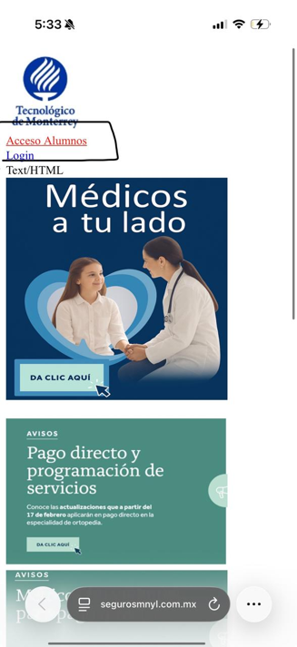
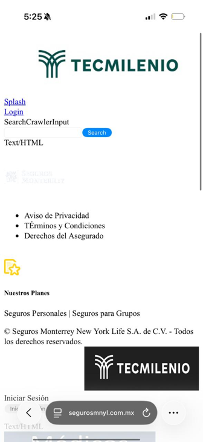
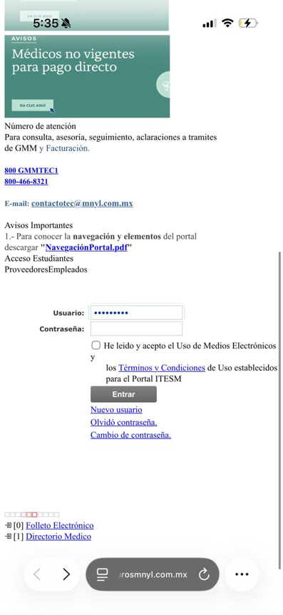
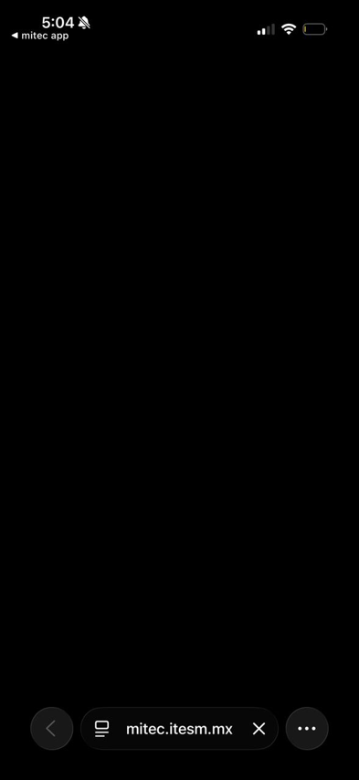
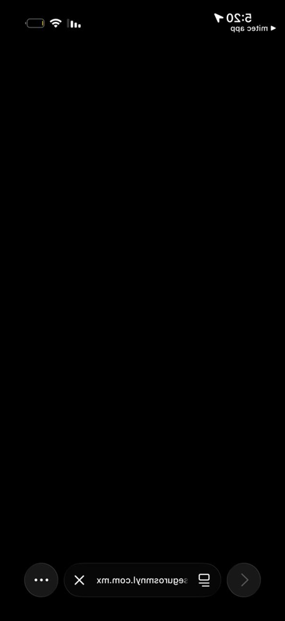
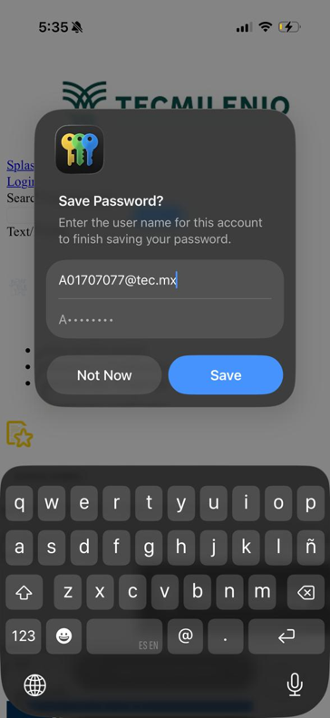
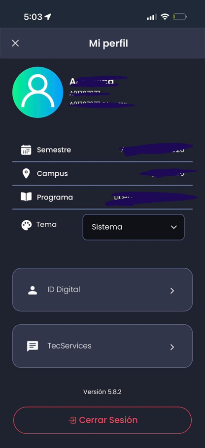
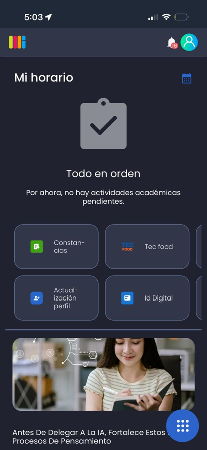
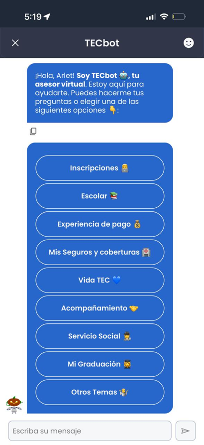
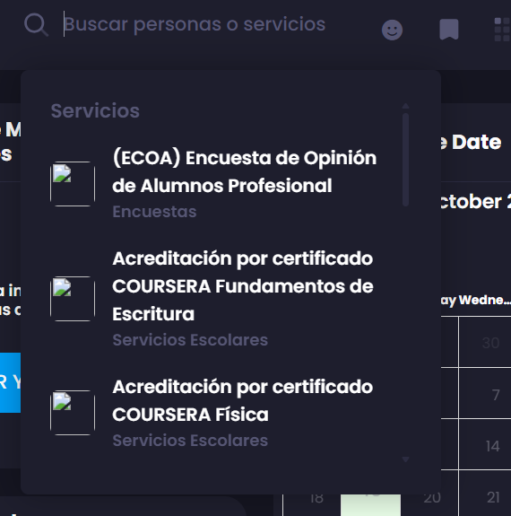

# Evaluacion heuristica - Equipo Teki
 
## Plataforma evaluada
Mitec, porque es una plataforma que los estudiantes del Tecnológico de Monterrey utilizan para consultar información académica y acceder a servicios universitarios; por lo tanto, es una herramienta que todos empleamos con frecuencia. Evaluarla nos permite identificar problemas de usabilidad que pueden afectar a tareas habituales, como consultar horarios, revisar calificaciones u obtener información sobre trámites administrativos.
 
## Tarea evaluada
- Tarea: “Quiero consultar mis calificaciones del semestre pasado para revisar mi desempeño académico”.
- Tarea: “Quiero revisar mi estado de cuenta para saber cuánto debo pagar de colegiatura”.
- Tarea: “Quiero consultar los requisitos que necesito para realizar un trámite escolar”.
- Tarea: "Quiero descargar mi póliza de SGMM para verificar fecha de vencimiento".

## Hallazgos
H1 a H8, ordenados de mayor a menor prioridad.

### H1. Botón inoperativo para descarga de documento ("Acceso Alumnos")
- Dónde: Portal "Médicos a tu lado" / Botón "Acceso Alumnos" en Chrome. 
- Principio: Retroalimentación (Violado: el botón no responde visiblemente ni da señal alguna tras ser presionado para realizar la acción). 
- Qué pasa: Tras ser redirigido desde el chatbot al navegador para descargar la póliza, le das clic al botón de "Acceso Alumnos" y no responde ni abre nada. 
- Consecuencia: Falla crítica del proceso e imposibilidad total de descargar la póliza desde el dispositivo móvil. 
- Evidencia: 

H2. Error de autenticación al asignar el dominio Tecmilenio
- Dónde: Portal de Salud / Flujo de inicio de sesión. 
- Principio: Restricciones (Violado: el sistema falla en las validaciones de acceso del usuario al permitir un enrutamiento de cuenta incorrecto). 
- Qué pasa: Al ingresar el usuario para acceder al portal de Salud y obtener la póliza, el sistema muestra un mensaje indicando que el usuario pertenece a "Tecmilenio". 
- Consecuencia: Bloqueo del acceso y falla en la autenticación del alumno. 
- Evidencia: 

### H3. Redirección incorrecta a TecMilenio al ingresar usuario y contraseña
- Dónde: Sitio web principal de inicio de sesión de mitec. 
- Principio: Mapeo (Violado: el flujo de entrada no lleva hacia donde el usuario espera, enviándolo a una plataforma externa desalineada con su acción). 
- Qué pasa: Al ingresar usuario y contraseña directamente en la página web de mitec, la plataforma redirige a una página de TecMilenio. 
- Consecuencia: Confusión, desconfianza sobre la seguridad del sitio e imposibilidad de acceder al portal correcto. 
- Evidencia: 
 
### H4. Fallo de carga e inicio colgado al ingresar desde el navegador
- Dónde: Pantalla de inicio de sesión/carga al acceder a mitec desde el navegador móvil. 
- Principio: Retroalimentación (Violado: el sistema se queda pasmado intentando abrir sin informar el estado actual del proceso). 
- Qué pasa: Al acceder directamente a la URL en el navegador, la página no carga y se queda congelada, funcionando únicamente mediante enlaces predeterminados previamente guardados. 
- Consecuencia: Pérdida de tiempo e imposibilidad de ingresar a la plataforma de forma directa. 
- Evidencia: 
 
### H5. Tiempos de espera y falta de sincronización entre la App y el navegador
- Dónde: Transición de la App de mitec hacia la pestaña del navegador (Chrome). 
- Principio: Retroalimentación (Violado: proceso de carga prolongado sin indicador claro de avance que obliga al usuario a recargar la página). 
- Qué pasa: La vinculación entre la app y el navegador es muy lenta; la pestaña se traba y requiere presionar refresh manualmente para poder cargar la solicitud. 
- Consecuencia: Demora en la navegación y riesgo de abandono del trámite. 
- Evidencia: 
 
### H6. Autenticación repetitiva en cada acceso (MFA)
- Dónde: Pantalla de inicio de sesión / Aplicación Autenticadora. 
- Principio: Restricciones (Violado: impone una traba de seguridad excesiva y rígida que rompe el flujo continuo del usuario a pesar de tener sesión previa). 
- Qué pasa: La aplicación exige ingresar el código del autenticador en cada intento de acceso, obligando a salir, copiar el código e ingresarlo constantemente. 
- Consecuencia: Fricción innecesaria y aumento del tiempo para realizar cualquier consulta. 
- Evidencia: 
 
### H7. Ausencia de botón de búsqueda y dificultad de navegación
- Dónde: Pantalla principal del portal mitec. 
- Principio: Visibilidad (Violado: funciones clave y herramientas de consulta esenciales para encontrar trámites como la póliza están ausentes u ocultas). 
- Qué pasa: La plataforma resulta poco clara para ubicar secciones importantes y carece de un botón o barra de búsqueda para agilizar la localización de trámites. 
- Consecuencia: Desorientación del usuario e incapacidad de localizar fácilmente los documentos requeridos. 
- Evidencia: 

### H8. Desorden en la presentación y agrupación del menú
- Dónde: Menú de navegación principal. 
- Principio: Mapeo (Violado: la organización y categorización de las opciones no sigue una lógica coherente con la expectativa del usuario). 
- Qué pasa: Existe un desorden en el menú al colocar servicios totalmente disímiles juntos en el mismo nivel (como "Constancias" al lado de "Tec Food"). 
- Consecuencia: Mayor esfuerzo de búsqueda y confusión en la arquitectura de la información. 
- Evidencia: 

### H9. Opciones limitadas en el menú del Chatbot de ayuda
- Dónde: Interfaz del Chatbot de atención al alumno. 
- Principio: Visibilidad (Violado: las rutas de navegación y alternativas de soporte están muy reducidas y poco expuestas al usuario). 
- Qué pasa: Al acudir al chatbot por la falta de claridad del menú principal, este solo ofrece un menú de opciones sumamente básico que no ayuda a resolver la consulta directamente. 
- Consecuencia: El usuario es redirigido fuera de la plataforma sin obtener una solución directa dentro de la herramienta. 
- Evidencia: 	

### H10. Inconsistencia visual en tipografía, formatos e imágenes
- Dónde: Diferentes pantallas y pasos del proceso en mitec. 
- Principio: Consistencia (Violado: variaciones constantes en tipografías, formatos de texto e imágenes a lo largo de las distintas secciones del sistema). 
- Qué pasa: Cada sección y paso del flujo presenta estilos tipográficos y de imagen distintos, rompiendo con la uniformidad del sitio. 
- Consecuencia: Muestra un diseño desintegrado que perjudica la experiencia estética y la percepción de profesionalismo. 
- Evidencia: 

## Matriz de priorizacion
Cada hallazgo se calificó por severidad (1 cosmética, 2 menor, 3 mayor, 4 crítica) y por frecuencia (pocas veces o casi cada uso). La lista de hallazgos está ordenada según este resultado.

| # | Hallazgo | Principio | Severidad | Frecuencia | Resultado |
|---|---|---|---|---|---|
| H1 | Botón "Acceso Alumnos" no responde | Retroalimentación | 4 · Crítica | Casi cada uso | Atender primero |
| H2 | La página no carga al entrar desde la URL | Retroalimentación | 3 · Mayor | Casi cada uso | Atender primero |
| H3 | Lentitud entre la app y el navegador | Retroalimentación | 3 · Mayor | Casi cada uso | Atender primero |
| H4 | No hay botón de búsqueda | Visibilidad | 3 · Mayor | Casi cada uso | Atender primero |
| H5 | Error de autenticación con dominio Tecmilenio | Restricciones | 4 · Crítica | Pocas veces | Atender después |
| H6 | Redirección a TecMilenio al iniciar sesión | Mapeo | 4 · Crítica | Pocas veces | Atender después |
| H7 | Código del autenticador en cada acceso | Restricciones | 2 · Menor | Casi cada uso | Atender después |
| H8 | Menú desordenado | Mapeo | 2 · Menor | Casi cada uso | Atender después |
| H9 | Tipografías e imágenes inconsistentes | Consistencia | 1 · Cosmética | Casi cada uso | Atender después |
| H10 | Chatbot con opciones limitadas | Visibilidad | 2 · Menor | Pocas veces | Dejar al final |

## Propuestas de mejora

### Mejora para H1. Botón inoperativo para descargar la póliza

- **Problema:** Al pulsar “Acceso Alumnos”, no ocurre nada y no se puede descargar la póliza desde el móvil.
- **Propuesta:** Hacer que el botón abra directamente el documento. Mientras carga, mostrar “Abriendo póliza…” y, si falla, ofrecer opciones para reintentar o descargarla desde otro enlace.
- **Principio que resuelve:** Retroalimentación y significante.
- **Resultado esperado:** El usuario sabe que su acción fue registrada y puede obtener la póliza o recuperarse del error.

### Mejora para H2. Error al asignar el dominio Tecmilenio

- **Problema:** El sistema identifica al alumno como parte de Tecmilenio y bloquea su acceso al Portal de Salud.
- **Propuesta:** Corregir la asignación automática de institución según la cuenta. Si no se puede identificar, pedir al usuario que seleccione su institución y explicar cómo corregir la elección.
- **Principio que resuelve:** Restricciones y retroalimentación.
- **Resultado esperado:** Se evitan redirecciones a una institución incorrecta y el usuario puede corregir la elección antes de quedar bloqueado.

### Mejora para H3. Redirección incorrecta después de iniciar sesión

- **Problema:** Después de ingresar sus credenciales en mitec, el usuario llega a una página de Tecmilenio y no sabe si está en el sitio esperado.
- **Propuesta:** Mantener la redirección vinculada al portal solicitado y mostrar el nombre de la institución de destino antes de continuar. Si se dirige al lugar equivocado, ofrecer una opción clara para regresar a mitec.
- **Principio que resuelve:** Mapeo y retroalimentación.
- **Resultado esperado:** El usuario entiende a dónde lo lleva el inicio de sesión y puede llegar al portal correcto sin repetir el proceso.

## Que aprendimos
Dos o tres lineas por integrante.

- Annelise Spears: Aprendí que una plataforma puede contar con todas las funcionalidades necesarias, pero si estas no resultan fáciles de encontrar o de comprender, la experiencia de usuario se ve afectada. La evaluación heurística ayudó a identificar estos problemas, así como a reconocer la importancia de contar con interfaces bien diseñadas y fáciles de usar.

- Miguel Elizalde: Aprendí que encontrar fallas es solo la mitad del trabajo; lo difícil es decidir cuál arreglar primero. Al cruzar severidad con frecuencia me di cuenta de que una falla menor que aparece en cada uso puede importar más que una crítica que casi nunca pasa. También entendí que si todo se marca como crítico, nada lo es.

- Arlet Velázquez: Al analizar la app de miTec, me di cuenta de lo crítico que es tener una aplicación móvil bien optimizada, ya que no pude completar la tarea correctamente por fallas de usabilidad desde el celular. Aprendí que una mala interfaz causa fricción innecesaria en cosas cotidianas y que aplicar los seis principios permite identificar con precisión dónde y por qué se rompe la experiencia de usuario. Además, entendí la importancia de priorizar los errores por su nivel de severidad en lugar de querer arreglar todo a la vez, lo que nos ayuda a enfocar los esfuerzos en lo que realmente le frustra al estudiante.

- Francesco Mosso: Aprendí que detectar un problema no es suficiente; también hay que entender cómo afecta al usuario y proponer una mejora concreta. Al trabajar en las propuestas, comprendí que priorizar por severidad y frecuencia ayuda a enfocarse primero en los obstáculos que impiden completar una tarea. También entendí que la plataforma debe indicar con claridad qué está pasando mientras el usuario la utiliza.